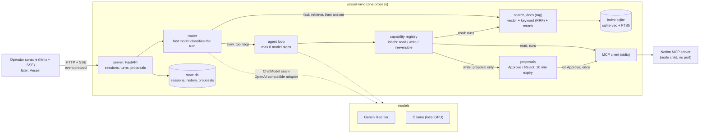

<div align="center">

# vessel-mind

**An agent runtime that cites its sources, routes each turn to the right model, and never writes without your Approve.**

[](pyproject.toml)
[](https://github.com/Manual-debuger/vessel-mind/actions/workflows/ci.yml)
[](LICENSE)

[](https://vessel-mind.hissnake.com)
[](https://chill-crocus-566.notion.site/Vessel-Mind-Public-Read-Only-4075c26c138880c98aa7e12b309df513)
[](#run-it)

[](README.md)
[](README.zh-TW.md)
[](docs/adr)
[](eval/results/results.md)

**English** · [繁體中文](README.zh-TW.md)

</div>

---

vessel-mind is a standalone agent runtime in Python. It answers questions about a pinned public
corpus with `[n]` citations, calls tools from an MCP server (Notion), and never runs a write
tool without a human's Approve. A router sends each turn to a fast model or a slow model, on
free-tier hosted models (Gemini) or on local models (Ollama). An operator console shows
everything a turn does: streamed text, every tool call, the route, token usage and proposals.

> [!TIP]
> **Live demo:** <https://vessel-mind.hissnake.com>. Sign in with any email address and the
> one-time PIN that Cloudflare Access sends to it. The agent reads
> [this public Notion page](https://chill-crocus-566.notion.site/Vessel-Mind-Public-Read-Only-4075c26c138880c98aa7e12b309df513),
> so you can check its answers. The demo runs in demo mode: ask it to change the page and you
> see its proposal, but every approval is refused, so nothing is written.

## Contents

- [Highlights](#highlights)
- [Public corpus only](#public-corpus-only)
- [Architecture](#architecture)
- [Event protocol](#event-protocol)
- [Run it](#run-it)
- [Results](#results)
- [Definition of done](#definition-of-done)
- [Development](#development)

## Highlights

| | |
|---|---|
| **Cited answers** | Hybrid retrieval (vector + keyword, fused with RRF, then reranked) over a pinned public corpus; answers cite the passages they use with `[n]` links. |
| **Human in the loop** | Tools are labelled `read`, `write` or `irreversible`. A read runs; a write becomes a proposal that runs once, only after Approve. Unlabelled MCP tools are never registered. |
| **Fast and slow paths** | A small model classifies each turn: retrieve-then-answer on the fast path, or a tool loop on the slow path. Each path can list fallback models. |
| **Free to run** | Gemini's free tier on a key with no billing account, or local models on Ollama. Every number below comes from free models. |
| **One protocol** | HTTP and Server-Sent Events, exported as a JSON Schema. The console uses nothing else, and so will Vessel, the author's voice companion. |
| **Bilingual** | Questions and the eval's golden set in English and in Traditional Chinese. |

The design is in
[ADR 0001](docs/adr/0001-an-agent-runtime-separate-from-embodiment.md) and
[ADR 0002](docs/adr/0002-demo-exposure-cloudflare-tunnel-access.md); the requirements are in
[the agent-track spec](docs/specs/a-agent-track.md); the terms are in the
[glossary](GLOSSARY.md).

## Public corpus only

Everything in this repository, its fixtures, its eval results and its screenshots comes from a
public corpus, and holds no personal data (ADR 0001 §7). The corpus is defined in
[`eval/corpus.yaml`](eval/corpus.yaml): each source is a repository, a pinned commit and path
globs.

- vessel-mind's own design documents: `docs/adr/`, `docs/specs/` and `GLOSSARY.md`, at `09a0890`.
- VibeConform (public, Apache-2.0): `README.md` and `docs/**/*.md`, at `384d89e`. The tarball is
  checked against its SHA-256.

Each Notion integration is shared with one demo page only, never a personal page.

### Gemini free-tier notice

The hosted configurations send messages to Google Gemini's free tier, on a key that belongs to a
Google Cloud project with no billing account. On the public host, the console shows this line:

> Messages are sent to Google Gemini's free tier, which may use them to improve its models. Do not enter personal data.

## Architecture



The package has four layers, and an import-linter contract checks them in
`tests/test_architecture.py`:

| Layer | Holds | May import |
|---|---|---|
| `core` | chat types, capabilities, credentials, protocol events | nothing else |
| `agent` | loop, router, proposals, MCP client, model adapter | `core` (never `rag`) |
| `rag` | chunk, embed, store, search, ingest | `core` |
| `server` | wires them together | all of the above |
| `eval` | the harness behind `task eval`, a second composition root | `server`, for config; nothing imports `eval` |

Retrieval reaches the loop as an injected `read` tool, `search_docs`.

Each path of a configuration can list fallback models (`fast_fallbacks`, `slow_fallbacks`):
when a model still fails after its retries (HTTP 429 or 503, or no first byte in time), the next
one answers, and the `route` event names the model that did. Each turn's route decision and
summary (status, steps, token usage; no message text) are appended to a JSONL telemetry file,
`data/state/telemetry.jsonl` by default.

The retrieval pipeline reranks on the CPU only (a fastembed cross-encoder). The `llama-server`
reranker that the spec offered as a second provider was cut: config refuses
`reranker: llama-server`.

### Deployment (ADR 0002)

```
reviewer --HTTPS--> Cloudflare Access (email PIN) --> Cloudflare Tunnel
                                                         | outbound only
  docker compose (project "vessel-mind")                 v
  +--------------------------------------------------------------------+
  | cloudflared (profile "tunnel", TUNNEL_TOKEN only) --> app:8000       |
  | app: uvicorn + console; the index and the models are in the image;  |
  |      state in the volume "state"; Notion MCP = node child (stdio)   |
  |      published on 127.0.0.1:8000 only                               |
  +--------------------------------------------------------------------+
        | host.docker.internal:11434 (local, routed)       | HTTPS
        v                                                  v
   Ollama (outside compose, no route from the tunnel)    Gemini free tier
```

## Event protocol

The protocol is the product boundary (ADR 0001 §6). The event models are exported as a JSON
Schema, [`schema/events.schema.json`](schema/events.schema.json), so a client can generate its
types from it. `task schema:export` regenerates it, and a test fails when the committed file
differs from the code.

| Endpoint | Purpose |
|---|---|
| `GET /health` | readiness |
| `POST /turns` | start a turn: body `{session_id?, text}`; no `session_id` creates a session; returns `{session_id, turn_id}`. A new turn cancels the session's running turn. Past `sessions.max_turns`: 429 `turn_limit`; past `sessions.max_turns_per_day` (all sessions together, per UTC day): 429 `daily_turn_limit`. |
| `GET /turns/{id}/events` | the turn's events as Server-Sent Events (`event:` is the type, the data is JSON, `id:` is the event's position); a reconnect with `Last-Event-ID` resumes after that event |
| `POST /turns/{id}/cancel` | cancel; the stream ends with `done` or `error`, never silently |
| `POST /proposals/{id}/approve` | run the proposed write once (idempotent by id); in demo mode: 403 `demo_mode` |
| `POST /proposals/{id}/reject` | discard the proposal; it never runs |

Events: `text` (a streamed delta), `tool_start`, `tool_result`, `proposal` (a write waiting for
Approve), `route` (fast or slow, the models and why), `done` (summed usage and the step count)
and `error`. An invalid request body is a 422. Sessions, their history and proposals are stored
in a SQLite state file apart from the retrieval index. At startup every pending proposal
expires, and a turn that was running is not resumed.

## Run it

| Configuration | Fast path | Slow path | Needs |
|---|---|---|---|
| `hosted` (default) | `gemini-3.5-flash-lite` | `gemini-3.6-flash` | `GEMINI_API_KEY` |
| `local` | `qwen3:8b` on Ollama | `qwen3.6:35b-a3b` on Ollama | a GPU with about 28 GB of VRAM |
| `routed` | `qwen3:8b` on Ollama | `gemini-3.6-flash` | both |

### Quick start: `hosted` with Docker

Google routes `gemini-3.5-flash` to `gemini-3.6-flash`, so the slow model is pinned as
`gemini-3.6-flash`. Use a key from a Google Cloud project with no billing account (AI Studio,
"Create API key").

```sh
git clone https://github.com/Manual-debuger/vessel-mind.git
cd vessel-mind
GEMINI_API_KEY=... docker compose up --build
```

Then open <http://127.0.0.1:8000>. The image is built with the retrieval index and both
retrieval models, so the first start embeds nothing; the build takes about 5 minutes. The build
reads `.git`, so a shallow clone (`--depth 1`), a source archive or a git worktree cannot be
built. Keys come from the shell or a git-ignored `.env` file; no file in the repository holds
one.

<details>
<summary><b>Without Docker</b></summary>

With Python 3.13, [uv](https://docs.astral.sh/uv/) and [Task](https://taskfile.dev/):

```sh
uv sync
task ingest                       # builds data/index.sqlite from the pinned corpus
GEMINI_API_KEY=... task dev       # http://127.0.0.1:8000
```

</details>

<details>
<summary><b>Configuration files and Notion</b></summary>

To change a setting, copy `config/agent.example.yaml` to `config/agent.yaml` (git-ignored); the
app reads that file when it exists. `VESSEL_MIND_CONFIG` names another file. The configuration
files name the environment variables (`key_env: NOTION_TOKEN`), never the secrets.

The Notion MCP server is off in the example; to enable it, run `npm ci --ignore-scripts` in
`deploy/notion-mcp`, set `mcp_servers.notion.enabled: true` and set `NOTION_TOKEN` (an
integration shared with one demo page only).

</details>

<details>
<summary><b>Local models with Ollama (<code>local</code>, no key)</b></summary>

`local` runs both paths on Ollama: `qwen3:8b` (fast, with `reasoning_effort: none`, so the
router's classification stays inside its 10 s timeout) and `qwen3.6:35b-a3b` (slow, a mixture
of experts with 3B active parameters). The pair needs about 28 GB of VRAM. With a 16384-token
context both models stay loaded on a 32 GB GPU:

```sh
ollama pull qwen3:8b
ollama pull qwen3.6:35b-a3b
OLLAMA_CONTEXT_LENGTH=16384 ollama serve
```

Then copy `config/agent.example.yaml` to `config/agent.yaml`, set `configuration: local`, and
run `task ingest` and `task dev` as above (no `GEMINI_API_KEY` needed). The example points the
`local` provider at Ollama's default `http://127.0.0.1:11434/v1`. In the Docker container,
`127.0.0.1` is the container: set `providers.local.base_url` to
`http://host.docker.internal:11434/v1` and start Ollama with `OLLAMA_HOST=0.0.0.0`.

`routed` uses `qwen3:8b` on Ollama for the fast path and `gemini-3.6-flash` for the slow path;
it needs both Ollama and `GEMINI_API_KEY`.

</details>

<details>
<summary><b>The public host (Cloudflare Tunnel and Access)</b></summary>

`config/agent.public.example.yaml` is the public host's configuration: `routed`, demo mode on
(the console shows proposals, and every approval is refused with 403 `demo_mode`), the
free-tier notice, a limit of 20 turns per session and of 100 turns a day across all sessions,
and a read-only Notion integration. Copy it to `config/agent.public.yaml` (git-ignored), put
the secrets and the file's name in a git-ignored `.env.public`, and start the tunnel too:

```sh
# .env.public
VESSEL_MIND_CONFIG=config/agent.public.yaml
GEMINI_API_KEY=...
NOTION_TOKEN=...   # the read-only integration
TUNNEL_TOKEN=...
```

```sh
docker compose --env-file .env.public --profile tunnel up -d --build
```

On the public host the console explains the demo to a visitor: what the agent answers from,
what to try, how to read an answer, and the turn limits. The optional `console` block links
the demo Notion page, published to the web, so a visitor can check the agent's answers against
it, and lists example questions that fill the question box when clicked.

A localhost configuration works the same way: `config/agent.local.yaml` (demo mode off) and
`.env.local` with the write integration's token.

The tunnel reaches only the app. The state file, the MCP servers and Ollama have no route from
the public hostname.

</details>

## Results

Every number here is copied from [`eval/results/results.md`](eval/results/results.md), which
`task eval` generates and nobody edits; `tests/test_readme.py` fails when this copy differs from
it. The golden set is [`eval/golden.yaml`](eval/golden.yaml): 35 questions over the public
corpus (English, Traditional Chinese written in Chinese, and unanswerable ones), each with
expected sources, key points and an expected route. The Traditional Chinese questions (zh-01
to zh-10) were drafted with an AI assistant, directly in Chinese, and the author reviewed each
one before the freeze ([`eval/golden-changes.md`](eval/golden-changes.md)).

<!-- results:begin -->

### 1. Retrieval ablation

No LLM calls (`task eval -- --retrieval-only`). Embedding model
`jinaai/jina-embeddings-v2-base-zh`; reranker `BAAI/bge-reranker-v2-m3-int8` (fastembed
cross-encoder on CPU) over the top 30 hybrid candidates. Every row returns the top 5. Latency is
one search on the author's CPU.

English (22 questions with expected sources, 25 timed):

| Retrieval | recall@5 | MRR@5 | p50 ms | p95 ms |
|---|---|---|---|---|
| vector | 0.66 | 0.71 | 20.6 | 24.2 |
| keyword | 0.81 | 0.89 | 3.9 | 9.5 |
| hybrid | 0.83 | 0.90 | 21.4 | 29.6 |
| hybrid + rerank | 0.83 | 0.89 | 13039.6 | 17569.3 |

Traditional Chinese (9 questions with expected sources, 10 timed):

| Retrieval | recall@5 | MRR@5 | p50 ms | p95 ms |
|---|---|---|---|---|
| vector | 0.51 | 0.67 | 23.8 | 164.9 |
| keyword | 0.77 | 0.83 | 3.8 | 11.9 |
| hybrid | 0.73 | 0.80 | 19.1 | 22.9 |
| hybrid + rerank | 0.77 | 0.89 | 13659.5 | 14918.2 |

### 2. End to end

| Row | Fast / slow model | Questions | recall@5 | MRR@5 | Answer score | Citation correctness | Turn p50 s | Turn p95 s | Tokens in / out | List-price cost (USD) |
|---|---|---|---|---|---|---|---|---|---|---|
| hosted | gemini-3.5-flash-lite / gemini-3.6-flash | *not run* | — | — | — | — | — | — | — | — |
| slow-only | router off / gemini-3.6-flash | *not run* | — | — | — | — | — | — | — | — |
| local | qwen3:8b / qwen3.6:35b-a3b | 35 of 35 | 0.82 | 0.88 | 0.85 | 0.71 (45 of 63) | 18.2 | 43.3 | 199,488 / 37,235 | $0 (GPU electricity not measured) |
| routed | qwen3:8b / gemini-3.6-flash | *not run* | — | — | — | — | — | — | — | — |
| local-slow-only | router off / qwen3.6:35b-a3b | 35 of 35 | 0.84 | 0.90 | 0.81 | 0.77 (46 of 60) | 16.4 | 31.9 | 178,836 / 41,980 | $0 (GPU electricity not measured) |

Router accuracy for `local` against `expected_route`: 0.57 (20 of 35 turns); 0 fallbacks to the
slow path; 1 costly misroute (en-03).

| Expected \ routed | fast | slow |
|---|---|---|
| fast | 5 | 15 |
| slow | 0 | 15 |

<!-- results:end -->

### What the end-to-end table measures, and what it does not

- **Table 2 ran on local models only.** `local` is `qwen3:8b` (fast, `reasoning_effort: none`)
  with `qwen3.6:35b-a3b` (slow); `local-slow-only` is `local` with the router off, so every turn
  takes the slow path. Ollama served both models with `OLLAMA_CONTEXT_LENGTH=16384`, so both
  stay loaded on a 32 GB GPU.
- **`hosted`, `slow-only` and `routed` are *not run*.** The reason, from results.md: their slow
  model gemini-3.6-flash allows 20 free-tier requests a day, and a row needs about 100 (answers
  and tool steps); the author chose to run the eval on free models within three days. No number
  for them is estimated.
- **The judge is `qwen3.6:35b-a3b`**, with the rubric [`eval/judge.md`](eval/judge.md). It is
  the slow model of both measured rows, so it shares their model family and its scores may
  favour them. Citation correctness is checked by code, not by the judge.
- **Judge–human agreement**, from results.md (the hand grades are in
  [`eval/human_grades.jsonl`](eval/human_grades.jsonl)):

  > The author graded 10 answers (32 key points) by hand, chosen at random (seed 15) from the judged answers. Judge and author agree on 30 of 32 key points (0.94). Mean answer score on these answers: judge 0.84, author 0.91.
- **Cost is at list price**: tokens × the provider's paid list price, dated in the config
  (Google's prices as of 2026-10-26). Nobody paid it. Self-hosted rows are $0, with GPU
  electricity not measured.
- Latency is the wall time of a turn on the author's machine, less the time the eval waited to
  space its requests.

## Definition of done

From [the spec](docs/specs/a-agent-track.md) §7. An open item names its reason.

- [x] `task verify` green locally (WSL2) and in CI (ubuntu and windows, 2026-10-27).
- [x] Module boundaries enforced: a forbidden import fails `tests/test_architecture.py`.
- [x] The adapter passes fixture tests, including parallel tool calls and cancellation
      (`tests/agent/test_openai_compatible.py`, recorded Gemini fixtures).
- [x] A write tool cannot execute without an approval (`tests/agent/test_loop.py`,
      `tests/server/test_proposals.py`).
- [x] Unlabelled MCP tools are not registered (`tests/agent/test_mcp_client.py`).
- [x] `schema/events.schema.json` committed and drift-tested (`tests/core/test_event_schema.py`).
- [x] Retrieval ablation table committed (vector / keyword / hybrid / hybrid + rerank).
- [x] `task eval` results committed for every configuration that could run: `local` and
      `local-slow-only`; `hosted`, `slow-only` and `routed` are *not run*, with the reason.
- [x] `docker compose up` from a clean clone serves the console with hosted providers only (the
      image was built from a fresh clone and the app became healthy). Open: a live Gemini turn
      in the container is not yet recorded.
- [ ] A 2–3 minute demo video, linked from this README. **Open:** the author records it. It
      needs a live Notion write on localhost through a proposal and Approve (#9), and one
      English and one Traditional Chinese question with `[n]` links and screenshots (#11).
- [ ] The manual tests of [the hand-off](docs/specs/a-agent-track-handoff.md#manual-test-plan):
      3, 4, 8 and 10 pass (2026-10-28 and 2026-10-29). **Open:** 1 passes over the HTTP API
      but is not yet checked in a browser; 5 has not run; 6 failed on 2026-10-29 because a
      cancelled turn left no route line (#28): the fix is merged, the test is not yet re-run;
      2, 7, 9 and 11 as above.
- [x] Public hostname behind Access, in demo mode, with Ollama not reachable from it
      (2026-10-28): the tunnel routes only `app:8000`; the author signed in with the email PIN
      and saw an approval refused; Notion refuses a write with the read-only token (#16).
- [x] README: architecture diagram, results tables, protocol summary, public-corpus statement;
      Vessel named as the future client and not linked while it is private.
- [x] Whole git history scanned for secrets: `gitleaks detect --log-opts="--all"` (v8.16.0)
      found none in the 63 non-merge commits of every branch (2026-10-30).

## Development

`task verify` is the full gate (formatting, lint, type check, tests); CI runs it on every pull
request. `task eval` runs the eval (`-- --retrieval-only` for table 1, `-- --config NAME
[--no-router]` for one row of table 2, `-- --render` to regenerate results.md). See
[`DEVELOPING.md`](DEVELOPING.md) for accepted advisories.

## License

[Apache License 2.0](LICENSE).

The agent skills in `.claude/skills/` keep their own licenses: those adapted from
[mattpocock/skills](https://github.com/mattpocock/skills) and `asd-ste100` are MIT, each with
the `LICENSE` file in its directory.
