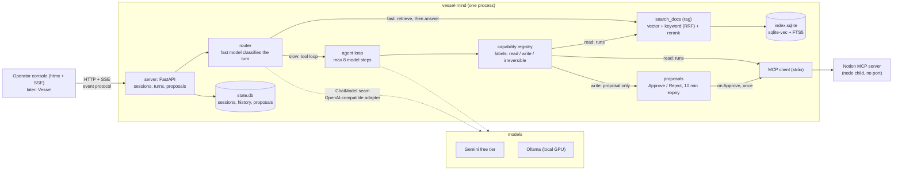

<div align="center">

# vessel-mind

**會引用來源、為每一輪挑選合適模型，而且沒有你按下 Approve 就絕不寫入的 agent runtime。**

[](pyproject.toml)
[](https://github.com/Manual-debuger/vessel-mind/actions/workflows/ci.yml)
[](LICENSE)

[](https://vessel-mind.hissnake.com)
[](https://chill-crocus-566.notion.site/Vessel-Mind-Public-Read-Only-4075c26c138880c98aa7e12b309df513)
[](#執行)

[](README.md)
[](README.zh-TW.md)
[](docs/adr)
[](eval/results/results.md)

[English](README.md) · **繁體中文**

</div>

---

vessel-mind 是一個用 Python 寫的獨立 agent runtime。它根據一組固定版本的公開語料回答問題，並用
`[n]` 標出引用來源；它可以呼叫 MCP server（Notion）提供的工具，但任何寫入工具都要經過人按下
Approve 才會執行。Router 會把每一輪對話分派給快模型或慢模型，模型可以是免費額度的雲端模型（Gemini），
也可以是本機模型（Ollama）。Operator console 會顯示每一輪做的所有事：串流的文字、每次工具呼叫、
路由、token 用量和 proposal。

> [!TIP]
> **線上 demo：** <https://vessel-mind.hissnake.com>。用任何 email 登入，輸入 Cloudflare Access
> 寄到信箱的一次性 PIN 即可。Agent 讀取的是
> [這個公開的 Notion 頁面](https://chill-crocus-566.notion.site/Vessel-Mind-Public-Read-Only-4075c26c138880c98aa7e12b309df513)，
> 你可以拿它對照答案。Demo 開著 demo mode：請它修改頁面，你會看到它提出的 proposal，但所有核准都會被拒絕，
> 不會寫入任何東西。

## 目錄

- [特色](#特色)
- [只用公開語料](#只用公開語料)
- [架構](#架構)
- [事件協定](#事件協定)
- [執行](#執行)
- [評測結果](#評測結果)
- [完成定義](#完成定義)
- [開發](#開發)

## 特色

| | |
|---|---|
| **附引用的回答** | 在固定版本的公開語料上做混合檢索（向量 + 關鍵字，以 RRF 合併後再 rerank）；回答用 `[n]` 連結標出引用的段落。 |
| **人在迴圈中** | 工具標記為 `read`、`write` 或 `irreversible`。讀取直接執行；寫入會變成 proposal，按下 Approve 後才執行，而且只執行一次。沒有標記的 MCP 工具一律不註冊。 |
| **快慢雙路徑** | 由小模型判斷每一輪：快路徑先檢索再回答，慢路徑跑工具迴圈。每條路徑都可以設定備援模型。 |
| **免費執行** | 使用沒有綁定帳單的 Gemini 免費額度，或 Ollama 上的本機模型。下方所有數字都來自免費模型。 |
| **單一協定** | HTTP 加 Server-Sent Events，並匯出成 JSON Schema。Console 只用這個協定，作者的語音夥伴 Vessel 之後也是。 |
| **雙語** | 提問和評測的 golden set 都有英文和繁體中文。 |

設計記錄在
[ADR 0001](docs/adr/0001-an-agent-runtime-separate-from-embodiment.md) 和
[ADR 0002](docs/adr/0002-demo-exposure-cloudflare-tunnel-access.md)；需求在
[agent-track spec](docs/specs/a-agent-track.md)；名詞定義在 [glossary](GLOSSARY.md)。
這些文件都是英文。

## 只用公開語料

這個 repository 裡的所有內容，包括測試資料、評測結果和截圖，都來自公開語料，不含任何個人資料
（ADR 0001 §7）。語料定義在 [`eval/corpus.yaml`](eval/corpus.yaml)：每個來源是一個 repository、
一個固定的 commit 和一組路徑 glob。

- vessel-mind 自己的設計文件：`docs/adr/`、`docs/specs/` 和 `GLOSSARY.md`，版本 `09a0890`。
- VibeConform（公開，Apache-2.0）：`README.md` 和 `docs/**/*.md`，版本 `384d89e`。下載的 tarball 會比對
  SHA-256。

每個 Notion integration 都只分享給一個 demo 頁面，絕不分享個人頁面。

### Gemini 免費額度聲明

雲端設定會把訊息送到 Google Gemini 的免費額度，使用的 key 屬於一個沒有帳單帳戶的 Google Cloud 專案。
在公開網站上，console 會顯示下面這段英文提示：

> Messages are sent to Google Gemini's free tier, which may use them to improve its models. Do not enter personal data.

（訊息會送到 Google Gemini 的免費額度，Google 可能用它們改進模型。請勿輸入個人資料。）

## 架構



套件分成四層，由 `tests/test_architecture.py` 裡的 import-linter 規則檢查：

| 層 | 內容 | 可以 import |
|---|---|---|
| `core` | 對話型別、capability、credential、協定事件 | 不 import 其他層 |
| `agent` | 迴圈、router、proposal、MCP client、模型 adapter | `core`（絕不 import `rag`） |
| `rag` | 切塊、embedding、儲存、搜尋、匯入 | `core` |
| `server` | 把上面各層組裝起來 | 以上全部 |
| `eval` | `task eval` 背後的評測工具，是第二個組裝點 | `server`（為了讀設定）；沒有任何層 import `eval` |

檢索以注入的 `read` 工具 `search_docs` 提供給 agent 迴圈。

每個設定的兩條路徑都可以列出備援模型（`fast_fallbacks`、`slow_fallbacks`）：當一個模型重試後仍然失敗
（HTTP 429 或 503，或在時限內沒收到第一個 byte），就由下一個模型回答，`route` 事件會寫出實際回答的模型。
每一輪的路由決策和摘要（狀態、步數、token 用量；不含訊息內容）會附加到 JSONL 遙測檔，預設是
`data/state/telemetry.jsonl`。

檢索流程只在 CPU 上做 rerank（fastembed cross-encoder）。Spec 原本列為第二個選項的 `llama-server`
reranker 已經砍掉：設定檔會拒絕 `reranker: llama-server`。

### 部署（ADR 0002）

```
reviewer --HTTPS--> Cloudflare Access (email PIN) --> Cloudflare Tunnel
                                                         | outbound only
  docker compose (project "vessel-mind")                 v
  +--------------------------------------------------------------------+
  | cloudflared (profile "tunnel", TUNNEL_TOKEN only) --> app:8000       |
  | app: uvicorn + console; the index and the models are in the image;  |
  |      state in the volume "state"; Notion MCP = node child (stdio)   |
  |      published on 127.0.0.1:8000 only                               |
  +--------------------------------------------------------------------+
        | host.docker.internal:11434 (local, routed)       | HTTPS
        v                                                  v
   Ollama (outside compose, no route from the tunnel)    Gemini free tier
```

## 事件協定

協定就是產品的邊界（ADR 0001 §6）。事件模型匯出成 JSON Schema
[`schema/events.schema.json`](schema/events.schema.json)，client 可以直接用它產生型別。
`task schema:export` 會重新產生這個檔案；commit 進去的檔案和程式碼不一致時，測試會失敗。

| Endpoint | 用途 |
|---|---|
| `GET /health` | 健康檢查 |
| `POST /turns` | 開始一輪：body 是 `{session_id?, text}`；沒給 `session_id` 就建立新的 session；回傳 `{session_id, turn_id}`。新的一輪會取消該 session 正在執行的那一輪。超過 `sessions.max_turns`：429 `turn_limit`；超過 `sessions.max_turns_per_day`（所有 session 合計，以 UTC 日計）：429 `daily_turn_limit`。 |
| `GET /turns/{id}/events` | 這一輪的事件，以 Server-Sent Events 傳送（`event:` 是類型，資料是 JSON，`id:` 是事件的位置）；斷線後帶 `Last-Event-ID` 重連，會從該事件之後繼續 |
| `POST /turns/{id}/cancel` | 取消；串流一定以 `done` 或 `error` 結束，不會無聲中斷 |
| `POST /proposals/{id}/approve` | 執行提議的寫入一次（同一個 id 重複呼叫不會重複執行）；demo mode 下回 403 `demo_mode` |
| `POST /proposals/{id}/reject` | 捨棄 proposal，它永遠不會執行 |

事件有：`text`（串流的文字片段）、`tool_start`、`tool_result`、`proposal`（等待 Approve 的寫入）、
`route`（快或慢、用了哪些模型、為什麼）、`done`（累計用量和步數）和 `error`。不合法的 request body 回 422。
Session、歷史和 proposal 存在一個 SQLite 狀態檔，和檢索索引分開。啟動時，所有待核准的 proposal 都會過期，
原本正在執行的一輪不會恢復。

## 執行

| 設定 | 快路徑 | 慢路徑 | 需要 |
|---|---|---|---|
| `hosted`（預設） | `gemini-3.5-flash-lite` | `gemini-3.6-flash` | `GEMINI_API_KEY` |
| `local` | Ollama 上的 `qwen3:8b` | Ollama 上的 `qwen3.6:35b-a3b` | 約 28 GB VRAM 的 GPU |
| `routed` | Ollama 上的 `qwen3:8b` | `gemini-3.6-flash` | 兩者都要 |

### 快速開始：用 Docker 跑 `hosted`

Google 會把 `gemini-3.5-flash` 導到 `gemini-3.6-flash`，所以慢模型直接固定為 `gemini-3.6-flash`。
請使用沒有帳單帳戶的 Google Cloud 專案的 key（AI Studio 的「Create API key」）。

```sh
git clone https://github.com/Manual-debuger/vessel-mind.git
cd vessel-mind
GEMINI_API_KEY=... docker compose up --build
```

然後打開 <http://127.0.0.1:8000>。Image 裡已經包含檢索索引和兩個檢索模型，第一次啟動不需要做任何
embedding；build 大約 5 分鐘。Build 時會讀 `.git`，所以 shallow clone（`--depth 1`）、原始碼壓縮檔或
git worktree 都無法 build。Key 從 shell 或 git-ignored 的 `.env` 檔讀取，repository 裡沒有任何檔案存放 key。

<details>
<summary><b>不用 Docker</b></summary>

需要 Python 3.13、[uv](https://docs.astral.sh/uv/) 和 [Task](https://taskfile.dev/)：

```sh
uv sync
task ingest                       # 從固定版本的語料建立 data/index.sqlite
GEMINI_API_KEY=... task dev       # http://127.0.0.1:8000
```

</details>

<details>
<summary><b>設定檔和 Notion</b></summary>

要修改設定，把 `config/agent.example.yaml` 複製成 `config/agent.yaml`（git-ignored）；這個檔案存在時，
app 就會讀它。`VESSEL_MIND_CONFIG` 可以指定其他檔案。設定檔裡只寫環境變數的名稱
（`key_env: NOTION_TOKEN`），不寫機密本身。

範例設定預設關閉 Notion MCP server。要開啟：在 `deploy/notion-mcp` 執行 `npm ci --ignore-scripts`，
設定 `mcp_servers.notion.enabled: true`，並設定 `NOTION_TOKEN`（只分享給一個 demo 頁面的 integration）。

</details>

<details>
<summary><b>用 Ollama 跑本機模型（<code>local</code>，不需要 key）</b></summary>

`local` 的兩條路徑都在 Ollama 上：`qwen3:8b`（快路徑，`reasoning_effort: none`，讓 router 的判斷能在
10 秒時限內完成）和 `qwen3.6:35b-a3b`（慢路徑，mixture of experts，啟用參數 3B）。兩個模型合計約需
28 GB VRAM。Context 設為 16384 token 時，兩個模型可以同時載入 32 GB 的 GPU：

```sh
ollama pull qwen3:8b
ollama pull qwen3.6:35b-a3b
OLLAMA_CONTEXT_LENGTH=16384 ollama serve
```

接著把 `config/agent.example.yaml` 複製成 `config/agent.yaml`，設定 `configuration: local`，再照上面執行
`task ingest` 和 `task dev`（不需要 `GEMINI_API_KEY`）。範例設定讓 `local` provider 連到 Ollama 的預設位址
`http://127.0.0.1:11434/v1`。在 Docker 容器裡，`127.0.0.1` 指的是容器本身：請把
`providers.local.base_url` 設為 `http://host.docker.internal:11434/v1`，並以 `OLLAMA_HOST=0.0.0.0`
啟動 Ollama。

`routed` 的快路徑用 Ollama 上的 `qwen3:8b`，慢路徑用 `gemini-3.6-flash`，所以 Ollama 和
`GEMINI_API_KEY` 都需要。

</details>

<details>
<summary><b>公開網站（Cloudflare Tunnel 和 Access）</b></summary>

`config/agent.public.example.yaml` 是公開網站的設定：`routed`、開啟 demo mode（console 會顯示 proposal，
但所有核准都回 403 `demo_mode`）、免費額度提示、每個 session 最多 20 輪、所有 session 每天合計最多 100 輪，
以及唯讀的 Notion integration。把它複製成 `config/agent.public.yaml`（git-ignored），把機密和設定檔名稱
寫進 git-ignored 的 `.env.public`，然後連同 tunnel 一起啟動：

```sh
# .env.public
VESSEL_MIND_CONFIG=config/agent.public.yaml
GEMINI_API_KEY=...
NOTION_TOKEN=...   # 唯讀的 integration
TUNNEL_TOKEN=...
```

```sh
docker compose --env-file .env.public --profile tunnel up -d --build
```

在公開網站上，console 會向訪客說明這個 demo：agent 根據什麼回答、可以試什麼、怎麼看回答，以及使用上限。
選填的 `console` 區塊可以連到已經公開到網路上的 demo Notion 頁面，讓訪客對照 agent 的回答，也可以列出
範例問題，點一下就會填進輸入框。

本機設定也用同樣的方式：`config/agent.local.yaml`（關閉 demo mode）搭配 `.env.local`，裡面放有寫入權限的
integration token。

Tunnel 只連得到 app。狀態檔、MCP server 和 Ollama 都沒有從公開網址進來的路徑。

</details>

## 評測結果

這裡的每個數字都複製自 [`eval/results/results.md`](eval/results/results.md)；那個檔案由 `task eval`
產生，沒有人手動修改。這份副本和原檔不一致時，`tests/test_readme.py` 會失敗。為了和產生的檔案逐字一致，
下面標記之間的內容保留英文。

Golden set 是 [`eval/golden.yaml`](eval/golden.yaml)：35 題針對公開語料的問題（英文、直接用中文撰寫的
繁體中文題，以及無法回答的題目），每題都有預期來源、要點和預期路由。繁體中文題（zh-01 到 zh-10）是
用 AI 助理直接以中文起草，作者在凍結前逐題審閱過（[`eval/golden-changes.md`](eval/golden-changes.md)）。

<!-- results:begin -->

### 1. Retrieval ablation

No LLM calls (`task eval -- --retrieval-only`). Embedding model
`jinaai/jina-embeddings-v2-base-zh`; reranker `BAAI/bge-reranker-v2-m3-int8` (fastembed
cross-encoder on CPU) over the top 30 hybrid candidates. Every row returns the top 5. Latency is
one search on the author's CPU.

English (22 questions with expected sources, 25 timed):

| Retrieval | recall@5 | MRR@5 | p50 ms | p95 ms |
|---|---|---|---|---|
| vector | 0.66 | 0.71 | 20.6 | 24.2 |
| keyword | 0.81 | 0.89 | 3.9 | 9.5 |
| hybrid | 0.83 | 0.90 | 21.4 | 29.6 |
| hybrid + rerank | 0.83 | 0.89 | 13039.6 | 17569.3 |

Traditional Chinese (9 questions with expected sources, 10 timed):

| Retrieval | recall@5 | MRR@5 | p50 ms | p95 ms |
|---|---|---|---|---|
| vector | 0.51 | 0.67 | 23.8 | 164.9 |
| keyword | 0.77 | 0.83 | 3.8 | 11.9 |
| hybrid | 0.73 | 0.80 | 19.1 | 22.9 |
| hybrid + rerank | 0.77 | 0.89 | 13659.5 | 14918.2 |

### 2. End to end

| Row | Fast / slow model | Questions | recall@5 | MRR@5 | Answer score | Citation correctness | Turn p50 s | Turn p95 s | Tokens in / out | List-price cost (USD) |
|---|---|---|---|---|---|---|---|---|---|---|
| hosted | gemini-3.5-flash-lite / gemini-3.6-flash | *not run* | — | — | — | — | — | — | — | — |
| slow-only | router off / gemini-3.6-flash | *not run* | — | — | — | — | — | — | — | — |
| local | qwen3:8b / qwen3.6:35b-a3b | 35 of 35 | 0.82 | 0.88 | 0.85 | 0.71 (45 of 63) | 18.2 | 43.3 | 199,488 / 37,235 | $0 (GPU electricity not measured) |
| routed | qwen3:8b / gemini-3.6-flash | *not run* | — | — | — | — | — | — | — | — |
| local-slow-only | router off / qwen3.6:35b-a3b | 35 of 35 | 0.84 | 0.90 | 0.81 | 0.77 (46 of 60) | 16.4 | 31.9 | 178,836 / 41,980 | $0 (GPU electricity not measured) |

Router accuracy for `local` against `expected_route`: 0.57 (20 of 35 turns); 0 fallbacks to the
slow path; 1 costly misroute (en-03).

| Expected \ routed | fast | slow |
|---|---|---|
| fast | 5 | 15 |
| slow | 0 | 15 |

<!-- results:end -->

### 端到端表格量了什麼、沒量什麼

- **表 2 只在本機模型上跑。** `local` 是 `qwen3:8b`（快路徑，`reasoning_effort: none`）搭配
  `qwen3.6:35b-a3b`（慢路徑）；`local-slow-only` 是關掉 router 的 `local`，每一輪都走慢路徑。Ollama 以
  `OLLAMA_CONTEXT_LENGTH=16384` 同時載入兩個模型，在 32 GB 的 GPU 上都能常駐。
- **`hosted`、`slow-only` 和 `routed` 標示為 *not run*。** 原因（出自 results.md）：它們的慢模型
  gemini-3.6-flash 免費額度每天只有 20 次請求，而跑一列大約需要 100 次（回答加上工具步驟）；作者選擇在
  三天內只用免費模型跑完評測。這幾列沒有任何估計數字。
- **評審模型是 `qwen3.6:35b-a3b`**，評分標準在 [`eval/judge.md`](eval/judge.md)。它也是兩列實測結果的
  慢模型，屬於同一個模型家族，分數可能偏向它們。引用是否正確由程式檢查，不由評審模型判斷。
- **評審模型和人工評分的一致度**，出自 results.md（人工評分在
  [`eval/human_grades.jsonl`](eval/human_grades.jsonl)）：

  > The author graded 10 answers (32 key points) by hand, chosen at random (seed 15) from the judged answers. Judge and author agree on 30 of 32 key points (0.94). Mean answer score on these answers: judge 0.84, author 0.91.

  作者從評審過的回答中隨機抽出 10 題（種子 15，共 32 個要點）人工評分。評審模型和作者在 32 個要點中有
  30 個一致（0.94）。這些回答的平均分數：評審模型 0.84，作者 0.91。
- **成本以牌價計算**：token 數 × 供應商的付費牌價，牌價日期寫在設定檔裡（Google 2026-10-26 的價格）。
  實際上沒有付任何費用。自架模型的列是 $0，GPU 電費沒有計算。
- 延遲是作者機器上一輪的實際經過時間，扣掉評測為了錯開請求而等待的時間。

## 完成定義

出自 [spec](docs/specs/a-agent-track.md) §7。未完成的項目會寫明原因。

- [x] `task verify` 在本機（WSL2）和 CI（ubuntu 和 windows，2026-10-27）都通過。
- [x] 模組邊界有強制檢查：違規的 import 會讓 `tests/test_architecture.py` 失敗。
- [x] Adapter 通過 fixture 測試，包括平行工具呼叫和取消
      （`tests/agent/test_openai_compatible.py`，錄製的 Gemini fixture）。
- [x] 寫入工具沒有核准就不能執行（`tests/agent/test_loop.py`、`tests/server/test_proposals.py`）。
- [x] 沒有標記的 MCP 工具不會被註冊（`tests/agent/test_mcp_client.py`）。
- [x] `schema/events.schema.json` 已 commit，並有一致性測試（`tests/core/test_event_schema.py`）。
- [x] 檢索消融表已 commit（vector / keyword / hybrid / hybrid + rerank）。
- [x] 所有能跑的設定都已 commit `task eval` 結果：`local` 和 `local-slow-only`；`hosted`、`slow-only` 和
      `routed` 標示為 *not run* 並寫明原因。
- [x] 從乾淨的 clone 執行 `docker compose up`，只用雲端模型就能提供 console（image 從全新的 clone
      build，app 狀態為 healthy）。未完成：容器內一輪真實的 Gemini 對話尚未記錄。
- [ ] 2–3 分鐘的 demo 影片，並從這份 README 連結。**未完成：**由作者錄製。需要在 localhost 透過
      proposal 和 Approve 真的寫入 Notion（#9），以及一題英文、一題繁體中文的問題，附 `[n]` 連結和截圖（#11）。
- [ ] [交接文件](docs/specs/a-agent-track-handoff.md#manual-test-plan)的手動測試：3、4、8 和 10 通過
      （2026-10-28 和 2026-10-29）。**未完成：**1 透過 HTTP API 測試通過，但還沒在瀏覽器裡確認；5 還沒跑；
      6 在 2026-10-29 未通過，因為被取消的輪次沒有留下 route 紀錄（#28）：修正已經合併，但還沒重測；
      2、7、9 和 11 見上方。
- [x] 公開網址在 Access 後面、開啟 demo mode，而且連不到 Ollama（2026-10-28）：tunnel 只轉送到
      `app:8000`；作者用 email PIN 登入，確認核准被拒絕；使用唯讀 token 時，Notion 會拒絕寫入（#16）。
- [x] README：架構圖、結果表格、協定摘要、公開語料聲明；提到 Vessel 是未來的 client，但在它還是私有專案時
      不放連結。
- [x] 掃描整個 git 歷史，確認沒有機密：`gitleaks detect --log-opts="--all"`（v8.16.0）在所有分支的
      63 個非 merge commit 中沒有發現任何機密（2026-10-30）。

## 開發

`task verify` 是完整的檢查（格式、lint、型別檢查、測試）；CI 在每個 pull request 上都會執行。
`task eval` 執行評測（`-- --retrieval-only` 產生表 1，`-- --config NAME [--no-router]` 產生表 2 的一列，
`-- --render` 重新產生 results.md）。已接受的安全公告見 [`DEVELOPING.md`](DEVELOPING.md)。

## 授權

[Apache License 2.0](LICENSE)。

`.claude/skills/` 裡的 agent skill 保留各自的授權：改編自
[mattpocock/skills](https://github.com/mattpocock/skills) 的 skill 和 `asd-ste100` 採用 MIT，
授權條款放在各自目錄的 `LICENSE` 檔。
